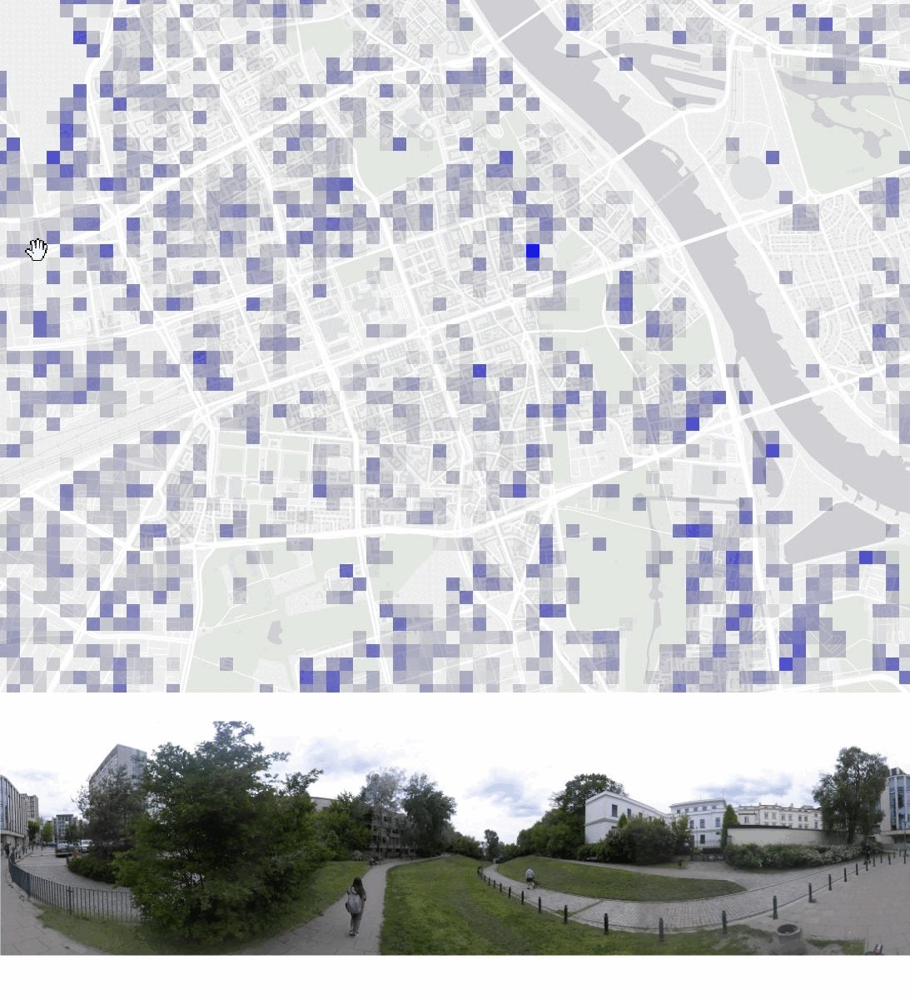
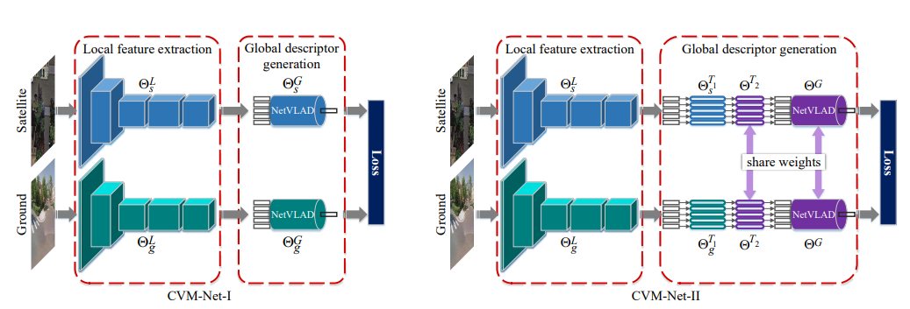
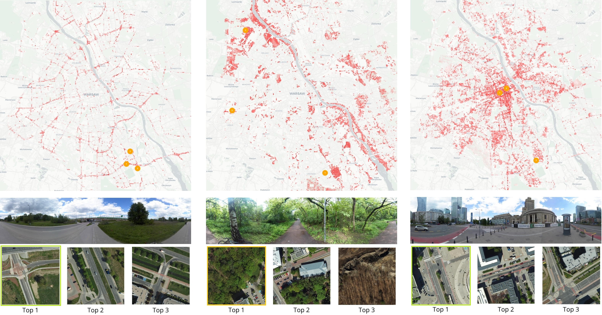
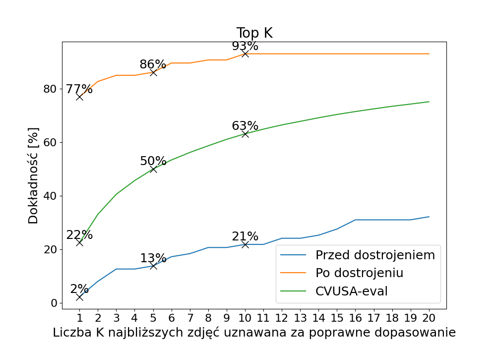
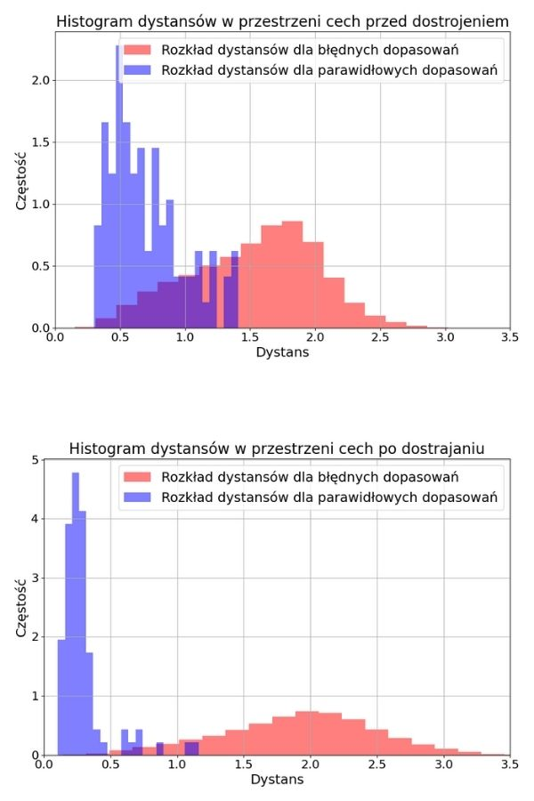
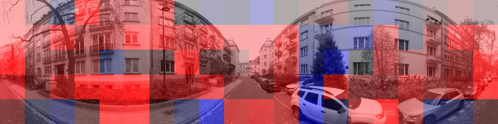
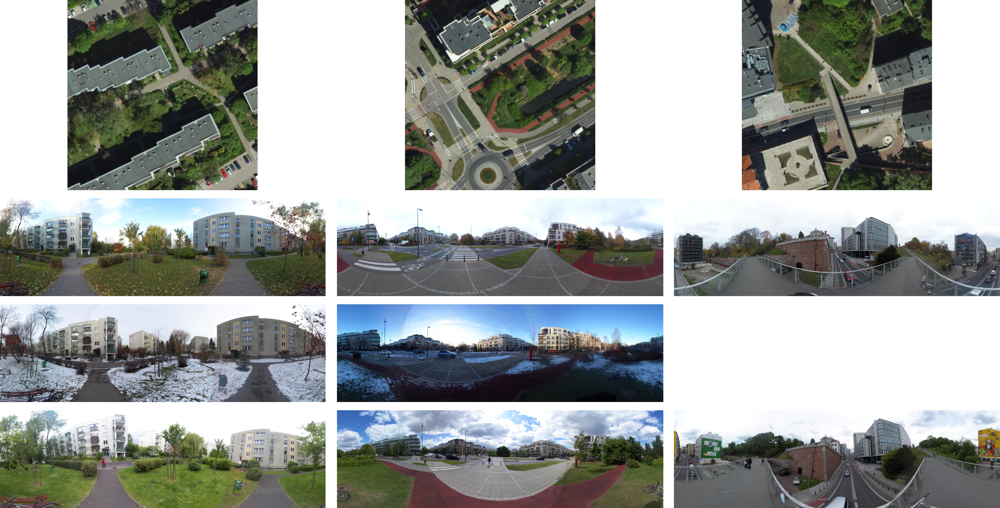
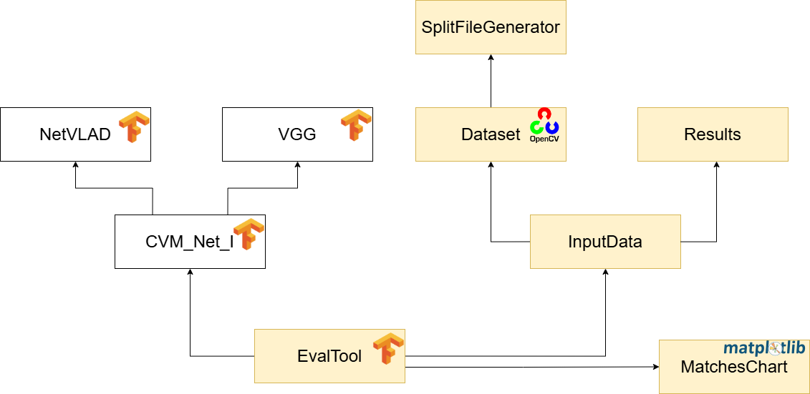

# Cross-View Visual Geolocalization Engine (GPS-Denied Navigation & OSINT)


-blue?style=for-the-badge)

> **TL;DR:** An end-to-end Computer Vision system that determines the geographic location of ground-level $360^{\circ}$ panoramic photos by matching them against $1.4\text{M+}$ overhead satellite/aerial map tiles—**without using GPS or EXIF metadata**. Built as a B.Sc. Engineering Thesis at the Warsaw University of Technology (2025).

---

## Visual Demo: City-Wide Sequence Localization

Locating a single ground photo across an entire metropolis ($62,465$ aerial tiles at Zoom 19) is highly ambiguous due to repetitive urban structures. To solve this, I designed a **spatial-temporal sequence filtering algorithm** that updates location probabilities over consecutive frames using Gaussian spatial smoothing.

<!-- 
💡 INSTRUKCJA DO GIFÓW: 
Wygeneruj klatki za pomocą skryptu `heatmap_seq.py` dla kolejnych kroków sekwencji (i = 1, 2, ..., n), 
połącz je w plik GIF (np. za pomocą ffmpeg lub ezgif.com) i wrzuć do folderu `docs/gifs/`.
-->
<div align="center">
  <table>
    <tr>
      <td align="center" width="50%">
        
        <br>
        <b>Sequence S4 (Warsaw City Center - 2.5 km)</b><br>
        <em>Converges to <b>Top-2</b> exact tile match out of 62,465 tiles.</em>
      </td>
      <td align="center" width="50%">
        
        <br>
        <b>Sequence S5 (Ursynów District - 3.7 km)</b><br>
        <em>Converges to <b>Top-1</b> exact tile match out of 62,465 tiles.</em>
      </td>
    </tr>
  </table>
</div>

---

## Key Engineering & ML Highlights

* **Data Engineering at Scale:** Built a custom geospatial dataset (**Warsaw Dataset** – **141 GB**, **1,432,268 files**) by scraping and stitching Web Mercator (`EPSG:3857`) aerial tiles across 4 zoom levels ($18\text{--}21$) and manually capturing multi-season $360^{\circ}$ street-level panoramas across 103 locations.
* **Domain Adaptation & Fine-Tuning:** Adapted the **CVM-Net** architecture (Siamese VGG16 + NetVLAD) from US training data (CVUSA) to European urban architecture, boosting **Top-1 accuracy from ~3% to ~77%** on challenging evaluation splits using only ~300 training pairs and rotational augmentation.
* **Sequence-Based Localization Algorithm:** Engineered a probabilistic trajectory tracker combining cosine similarity in a $4096\text{-D}$ feature space with $5 \times 5$ Gaussian kernel propagation, achieving **Top-1 / Top-2 city-wide localization** on 4 out of 5 test routes.
* **Modular Evaluation Framework (`EvalTool`):** Refactored legacy research code into an extensible, OOP Python framework driven by JSON configuration pipelines for automated hyperparameter tuning, XAI occlusion sensitivity analysis, and geospatial visualization.

---

## How It Works

### 1. Cross-View Feature Extraction (Siamese CNN + NetVLAD)
To bridge the extreme perspective gap between a horizontal street view and an orthogonal bird's-eye view, the system uses **CVM-Net-I**:
* **Backbone:** Dual-branch Siamese **VGG16** extracts local convolutional features from both the cropped ground panorama ($1232 \times 224\text{ px}$) and the aerial tile ($512 \times 512\text{ px}$).
* **Aggregation:** **NetVLAD** layers pool local features into $64$ learnable clusters, projecting each image into a shared, L2-normalized **$4096\text{-D}$ global descriptor** space.
* **Matching & Training:** Trained with **Weighted Soft-Margin Triplet Loss** ($\alpha = 10.0$) using doubled cosine distance:
  $$\|f(A) - f(P)\|_{\cos} = 2(1 - f(A) \cdot f(P))$$

<div align="center">
  
  <p><em>Figure 1: Siamese CVM-Net-I architecture with VGG16 and NetVLAD layers.</em></p>
</div>

### 2. Probabilistic Sequence Filtering
While a single panorama mainly identifies *terrain type* (e.g., parks, dense intersections, main arteries), combining sequential measurements along a route isolates the exact geographic trajectory:

$$P(i) = \alpha \cdot \text{Measure}(l_i) \cdot \left(P(i-1) * G_{5\times5, \sigma=1}\right) + \beta \cdot P(i-1)$$

<div align="center">
  
  <p><em>Figure 2: Single-image similarity heatmaps across Warsaw - capable of semantic scene matching (highways, parks, downtown) before sequence filtering narrows down the exact location.</em></p>
</div>

---

## Key Results & Model Explainability (XAI)

### Domain Adaptation (Fine-Tuning on Warsaw)
Fine-tuning the US-pretrained model on a diverse mix of Warsaw districts (with $45^{\circ}$ horizontal roll augmentations) drastically separated positive and negative feature distributions:

<div align="center">
  <table>
    <tr>
      <td align="center" width="50%">
        
      </td>
      <td align="center" width="50%">
        
      </td>
    </tr>
  </table>
  <p><em>Figure 3: Before vs. After Fine-Tuning (Variant 3 + 1,000 distractor tiles). Top-1 accuracy jumped from <b>~3% to ~77%</b>, with Top-10 exceeding <b>90%</b> </em></p>
</div>

### Occlusion Sensitivity & Input Optimization
By systematically masking grid patches ($20 \times 10$) and tracking feature distance shifts, I proved that the uncropped sky and ground introduce noise. Cropping **$600\text{ px}$ from the top** and **$1000\text{ px}$ from the bottom** more than doubled baseline Top-1 accuracy (**$12.0\% \rightarrow 28.7\%$**).

<div align="center">
  
  <p><em>Figure 4: Explainable AI (XAI) occlusion heatmaps. Blue = features critical for correct matching (building facades, tree lines); Red = distracting regions (sky, pavement) (Thesis Fig. 7.9, p. 41).</em></p>
</div>

### Robustness Summary
* **Optimal Aerial Scale:** Zoom level **19** ($0.18\text{ m/px}$, covering $\sim 93\text{ m} \times 93\text{ m}$ per $512\times512\text{ px}$ tile) yielded the highest accuracy (**$28.7\%$ Top-1**, **$78.4\%$ Top-10**), outperforming Zoom 18, 20, and $45^{\circ}$ oblique aerial views.
* **Hardware & Horizon Invariance:** Model performance remained stable across different $360^{\circ}$ cameras (Kodak PixPro vs. Ricoh Theta S) and uncalibrated horizon tilts.
* **Seasonality:** High resilience between Autumn (**$43.0\%$ Top-1**) and Spring (**$45.3\%$ Top-1**), with expected degradation in heavy Winter snow (**$27.9\%$ Top-1**) prior to seasonal fine-tuning.

---

## The Custom "Warsaw" Dataset (141 GB)

To overcome the limitations of Google Street View benchmarks (which lack seasonal variety, off-road pedestrian paths, and multi-device captures), I built the **Warsaw Dataset** from scratch:
* **Ground Panoramas:** Captured across **103 locations** (Wilanów, Ursynów, Centrum) in **Autumn, Winter, and Spring**, plus **5 continuous pedestrian trajectories** ($1.2\text{ km to } 4.1\text{ km}$).
* **Aerial Imagery:** **1,423,239 orthogonal tiles** covering the entire Warsaw metropolitan area + **3,150 oblique ($45^{\circ}$)** directional patches (N, S, E, W).

<div align="center">
  
  <p><em>Figure 5: Multi-season panoramic captures (Autumn, Winter, Spring) paired with Zoom 19 orthogonal aerial tiles across three Warsaw districts.</em></p>
</div>

---

## Software Architecture (`EvalTool`)

The repository features an object-oriented evaluation and data processing pipeline (`EvalTool`) along with standalone geospatial utilities:

<div align="center">
  
  <p><em>Figure 6: Modular architecture of the EvalTool framework.</em></p>
</div>

* `EvalTool` & `InputData`: JSON-driven experiment runner supporting automated dataset filtering (by season, district, camera, zoom) and metric computation (`Top-K`, `Top-K%`).
* `meractor_map_scraper.py`: Automated Web Mercator (`EPSG:3857`) tile scraper and $512\times512\text{ px}$ stitcher.
* `heatmap.py` & `heatmap_seq.py`: Geospatial probability renderers generating static and sequential Folium/Leaflet heatmaps.
* `occluded_image_generator.py` & `occlusion_viewer.py`: XAI sensitivity analysis suite.

### Quick Start

```bash
# 1. Clone the repository & set up Python 3.9 environment
git clone https://github.com/your-username/cross-view-geolocalization-warsaw.git
cd cross-view-geolocalization-warsaw
pip install tensorflow==2.10.1 opencv-python==4.10.0.84 numpy==1.26.4 pandas==2.2.3 geopandas==1.0.1 folium==0.19.5 mercantile==1.2.1 matplotlib==3.9.2

# 2. Run an evaluation pipeline via JSON config
python eval_tool.py --config configs/warsaw_zoom19_eval.json

# 3. Generate sequence localization heatmap frames (for GIF creation)
python scripts/heatmap_seq.py --config configs/sequence_S5.json --output docs/gifs/frames_S5/
```

---

## Contact
 If you have any questions or you need a dataset please write here:

**Email:** marcin.kowalczyk230gmail.com